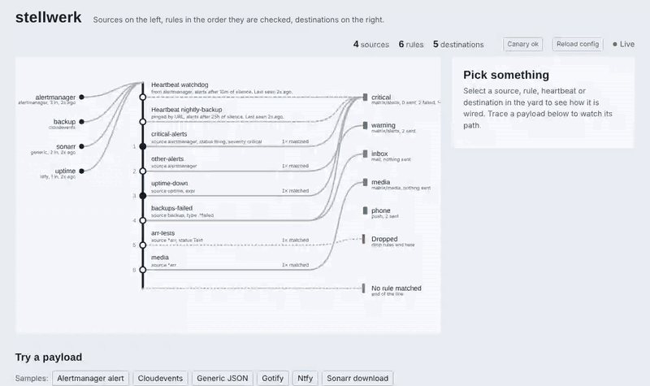

# stellwerk

[](https://github.com/johnnycube/stellwerk/actions/workflows/ci.yml)
[](https://github.com/johnnycube/stellwerk/actions/workflows/e2e.yml)
[](https://github.com/johnnycube/stellwerk/releases)
[](LICENSE)

**One place for every notification your systems send.** stellwerk receives webhooks from anything that can call a URL, decides by rules what matters and where it goes, and delivers it: end-to-end encrypted into Matrix rooms, by mail, as a push notification or to another webhook. If the main channel is down, it switches to a fallback. If something that should keep talking goes quiet, it tells you.

*Stellwerk* is German for *signal box*: the building next to the tracks where every switch and signal of a station is set.



## Why stellwerk exists

A homelab or a small platform has a dozen things that want to tell you something: Alertmanager, Grafana, Uptime Kuma, Proxmox, the backup job, the media apps, CI, Kubernetes events. Each one has its own notification settings, and they end up spread over a chat app, a mail folder and a push service, often through someone else's cloud. That leads to the same problems everywhere:

- **No single place decides what is important.** Every app is configured on its own, so "page me at night" and "a summary in the morning is fine" are scattered over many settings screens.
- **Alerts leak.** Hostnames, IP addresses and error messages go through third-party services in plain text.
- **Silence looks like good news.** When the alerting path breaks, nothing arrives, and that looks the same as everything being fine.
- **Noise wins.** A night of downloads or a flapping pod buries the one message that matters.

stellwerk is the switchboard in the middle. Senders only need one URL. The rules live in one file you can review and test. Messages go out end-to-end encrypted to a homeserver you control. And the path itself is watched: heartbeats, a daily canary, fallbacks and a self ping make sure a broken alerting path shows up as an alarm instead of silence.

It is one binary with a SQLite file and no other dependencies. It runs on a Raspberry Pi, a VPS or as a Helm release.

**What it is not:** stellwerk does not evaluate metrics. It sits after Alertmanager, Grafana or Uptime Kuma, not in place of them. It also has no on-call schedules or escalation by acknowledgement yet (see the [roadmap](ROADMAP.md)).

## How it works

```
 sources                 rules, checked in order                destinations
 alertmanager ─┐                                                ┌─ critical  matrix/alerts  ⤷ fallback: push, mail
 sonarr ───────┤   POST /in/{source}   1 critical-alerts ───────┼─ pager     webhook
 k8s-events ───┼──► decode ──► ═══════ 2 other-alerts ──────────┼─ warning   matrix/alerts
 backup ───────┘   heartbeats ◄        3 media ─────────────────┴─ media     matrix/media
```

1. **Sources** are the senders. Each one has a kind (`alertmanager`, `generic`, `cloudevents`, `ntfy`, `gotify`) that decodes its payload, and proves who it is with a token, an HMAC signature (GitHub, Gitea, Forgejo) or both. Apps that can notify ntfy or Gotify only need a new server URL.
2. **Rules** match on source, status, labels and JSON fields, plus an optional [CEL](https://cel.dev) expression. First match wins, `continue` fans out, `drop` swallows noise, `digest: 1h` folds a busy hour into one message.
3. **Destinations** are named places: a Matrix room, a mail address, an ntfy topic, a webhook. Each can name **fallbacks** for when it cannot be reached.
4. **Targets** do the delivery. One target can have several **accounts**, e.g. a Matrix bot that pages you and a quieter one for media, each with its own login and queue.

Around that: a durable spool so nothing accepted gets lost, retries that respect rate limits, a circuit breaker, silences from the UI or the chat (`!stellwerk mute 2h source=k8s`), heartbeats and ping URLs for cron jobs, an audit log that explains every decision, Prometheus metrics, and optional high availability without extra infrastructure.

## Onboarding

### 1. Install

| Where | How |
|---|---|
| Linux binary | amd64 and arm64 archives on the [releases page](https://github.com/johnnycube/stellwerk/releases) |
| Container | `ghcr.io/johnnycube/stellwerk`, multi-arch and signed with cosign, see [`deploy/docker-compose.yaml`](deploy/docker-compose.yaml) |
| Kubernetes | `helm install stellwerk oci://ghcr.io/johnnycube/charts/stellwerk -f values.yaml`, see [the chart](deploy/helm/stellwerk) |
| From source | `CGO_ENABLED=1 go build -tags goolm -o stellwerk ./cmd/stellwerk` |

Verify an image:

```sh
cosign verify ghcr.io/johnnycube/stellwerk:<version> \
  --certificate-identity-regexp 'https://github.com/johnnycube/stellwerk/' \
  --certificate-oidc-issuer https://token.actions.githubusercontent.com
```

### 2. Create a config

**With Matrix.** Create a user for the bot on your homeserver, then let `stellwerk init` do the rest:

```sh
stellwerk init -homeserver https://matrix.example.org -user @stellwerk:example.org -invite @me:example.org
set -a; . ./stellwerk.env; set +a
stellwerk -config stellwerk.yaml
```

`init` logs the bot in, sets up cross-signing so Element shows it as verified, creates an encrypted room, invites you, posts a first message and writes `stellwerk.yaml` and `stellwerk.env` with generated tokens and keys. The password comes from `$STELLWERK_INIT_PASSWORD` or a prompt.

**Without Matrix.** Push and mail work on their own. A complete config:

```yaml
sources:
  alertmanager: { kind: alertmanager, token: "${TOKEN_ALERTMANAGER}" }
  "*":          { kind: generic,      token: "${TOKEN_DEFAULT}" }

targets:
  push: { type: ntfy, settings: { url: https://ntfy.sh } }
  mail:
    type: email
    settings: { host: smtp.example.org, username: alerts@example.org, password: "${SMTP_PASSWORD}", from: "stellwerk <alerts@example.org>" }

destinations:
  phone: { target: push, address: my-unguessable-topic, fallback: [inbox] }
  inbox: { target: mail, address: me@example.org }

routes:
  - { name: critical, match: { source: alertmanager, labels: { severity: critical } }, to: phone, loud: true }
  - { name: everything-else, match: { source: "*" }, to: inbox }

heartbeats:
  - { name: watchdog, source: alertmanager, labels: { alertname: Watchdog }, timeout: 10m, to: phone }

delivery: { spool: ./spool.db }
ui: { listen: "127.0.0.1:8081" }
```

[`stellwerk.example.yaml`](stellwerk.example.yaml) shows every section with comments. Editors with the YAML language server complete and check the file against [the JSON schema](docs/stellwerk.schema.json). Secrets can come from environment variables or mounted files instead of the YAML, see [where config comes from](docs/configuration.md#where-config-comes-from).

```sh
stellwerk -check          # validates config, rules, templates and expressions
stellwerk -print-config   # the merged result, secrets redacted
```

### 3. Connect the first sender

Send a test message:

```sh
curl -H "Authorization: Bearer $TOKEN_DEFAULT" -d '{"text": "hello from stellwerk"}' http://localhost:8080/in/test
```

Then point your apps at `https://<your-host>/in/<source>`. The [recipes](docs/recipes) have copy and paste setups for Alertmanager, Grafana, Uptime Kuma, the *arr apps, Proxmox, TrueNAS, Home Assistant, Watchtower, Diun, GitHub, Gitea, Forgejo and cron jobs.

### 4. Shape the rules and test them

Open the dataflow UI at `http://127.0.0.1:8081`. It draws your setup as a switchyard with live counters. **Try a payload** shows which rule a body would hit and why, without sending anything. The audit log shows every real message with each rule's verdict and every send attempt.

Put the cases you care about into the config, and let CI check them on every change:

```yaml
tests:
  - name: critical alerts go to the phone
    source: alertmanager
    body: '{"version":"4","status":"firing","commonLabels":{"severity":"critical"},"alerts":[]}'
    expect: { to: [phone], loud: true }
```

`stellwerk -test` runs them with the real decoders and rules, sends nothing and exits 1 if one fails.

### 5. Make it trustworthy

Before you rely on stellwerk for things that matter:

- [ ] `delivery.spool` is set and on persistent storage, so accepted messages survive a restart.
- [ ] Important destinations have a `fallback` on a different channel (mail or push if Matrix is the main one).
- [ ] Alertmanager's `Watchdog` (or another regular sender) is a heartbeat, so a dead monitoring stack pages you.
- [ ] A daily `canary` proves the whole path, optionally read back by a second Matrix account.
- [ ] `self_ping` points at an outside check such as healthchecks.io, the one alarm stellwerk cannot raise about itself.
- [ ] For Matrix: the data directory and `pickle_key` are backed up together.

[Operations](docs/operations.md) explains each of these.

## Targets

| Target | Status | Delivers to |
|---|---|---|
| `matrix` | available | Encrypted rooms (E2EE, cross-signed bot devices, mentions, chat commands, canary read-back) |
| `email` | available | Any SMTP server, STARTTLS or implicit TLS, priority headers |
| `ntfy` | available | ntfy.sh or your own ntfy server, priorities and tags |
| `webhook` | available | Any HTTP endpoint, a fixed JSON body. Through n8n or Node-RED it reaches anything until a native target exists |

### Coming next

The order follows what most setups ask for. Every target is an adapter behind the same port and has to pass the same contract tests, so each can be added without touching the core ([how](docs/extending.md#a-new-target-type)).

| Phase | Targets | Why |
|---|---|---|
| **Next: team chat** | Slack, Discord, Mattermost, Microsoft Teams, Telegram | Where many teams already are. Slack, Discord and Mattermost through incoming webhooks or bot tokens, Teams through Workflows webhooks with Adaptive Cards, Telegram through the Bot API. Markdown is converted to each platform's dialect. |
| **Then: push and private messengers** | Gotify, Pushover, Signal (through signal-cli REST), UnifiedPush | More independent second channels for fallbacks. Gotify and ntfy can then be both a source and a target. |
| **Then: paging** | PagerDuty (Events API v2), SMS and voice calls (Twilio or a European provider) | The last escalation step, and the basis for acknowledgement and escalation chains. |
| **Later: work items and pipelines** | GitHub and Forgejo issues, Jira, NATS, Kafka | Turn an alert into a ticket, or forward events into downstream systems. |

Want a target that is not listed, or one moved up? [Open an issue](https://github.com/johnnycube/stellwerk/issues). The full roadmap, including replicated delivery, escalation with acknowledgement and AI enrichment, is in [ROADMAP.md](ROADMAP.md).

## Documentation

| | |
|---|---|
| [Configuration](docs/configuration.md) | Config layers, targets and accounts, fallbacks, spool, source kinds, expressions, templates |
| [Operations](docs/operations.md) | Silences, chat commands, digests, ping URLs, canary, rule tests, reload, reliability, high availability, audit log, metrics, UI |
| [Recipes](docs/recipes) | App by app setups |
| [Architecture and testing](docs/ARCHITECTURE.md) | Hexagonal core, use cases, ports, test strategy |
| [Extending](docs/extending.md) | New sources, targets, expression engines, spools, coordinators |
| [Decisions](docs/adr) | Architecture decision records |
| [Changelog](CHANGELOG.md) | What changed in each release |

## Development

```sh
make tools    # the pinned linters, scanners and fleetlint
make          # quick check before a commit
make check    # the definition of green, the same target CI runs
make help     # every target
go test -tags "goolm e2e" ./test/e2e   # against a real Synapse, see the file header
```

`goolm` selects the pure Go Olm implementation, so no libolm is needed. CGO stays on for SQLite. The architecture test in `internal/archtest` keeps the core free of adapters. See [CONTRIBUTING.md](CONTRIBUTING.md).

## Security

Please report vulnerabilities privately, see [SECURITY.md](SECURITY.md).

## License

Apache License 2.0, see [LICENSE](LICENSE) and [NOTICE](NOTICE).
